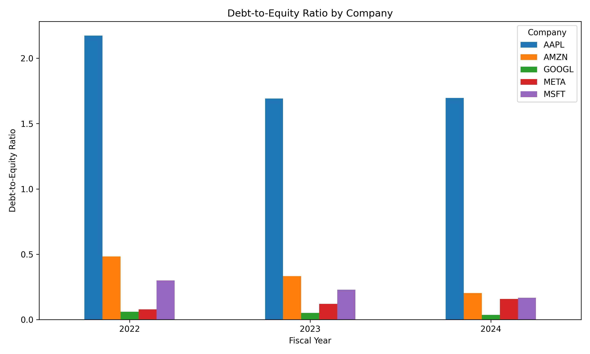
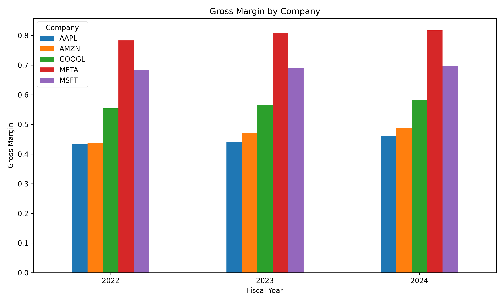
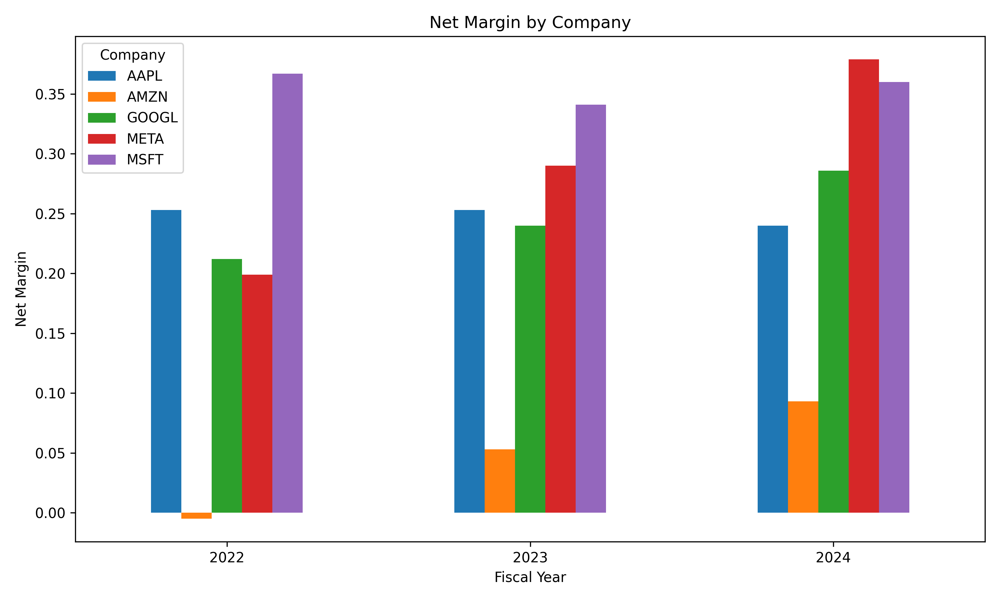
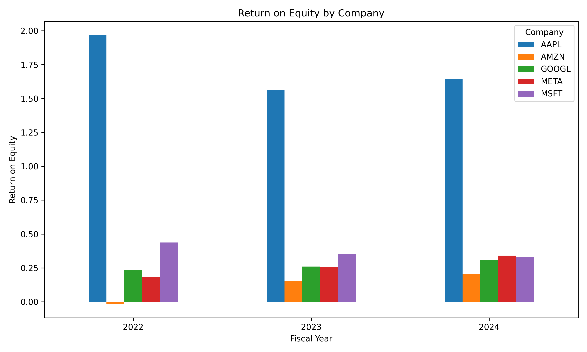

# SEC EDGAR Financial Ratio Analysis

**Python · SEC EDGAR API · pandas · SQLite · SQL · Matplotlib**

A reproducible financial-analysis project that downloads public-company XBRL facts from the U.S. Securities and Exchange Commission (SEC), builds a standardized company-year dataset, calculates four financial ratios in SQL, and visualizes differences in profitability and leverage.

## Project overview

This project compares five large U.S.-listed technology and technology-adjacent companies over **2022–2024**. It demonstrates a small end-to-end data pipeline: acquiring SEC data, identifying usable accounting concepts, handling differences in XBRL tags, validating a clean dataset, querying a SQLite database, and presenting results through charts and business observations.

**Scope:** 5 companies × 3 fiscal years = **15 company-year observations**. The years are the three most recent common years supported by the locally downloaded data and the project's extraction rules; they are **not** a claim that 2024 is the latest available SEC filing year.

## Companies and fiscal years

| Ticker | Company | Years in analysis |
| --- | --- | --- |
| AAPL | Apple | 2022, 2023, 2024 |
| MSFT | Microsoft | 2022, 2023, 2024 |
| GOOGL | Alphabet | 2022, 2023, 2024 |
| AMZN | Amazon | 2022, 2023, 2024 |
| META | Meta Platforms | 2022, 2023, 2024 |

**Fiscal-year convention:** The `fiscal_year` column uses the calendar year of the reported fiscal period's **end date**. The underlying fiscal year-ends differ: for example, Microsoft's fiscal year ends in June, Apple's in September, and Alphabet/Amazon/Meta generally in December. Comparisons are therefore between each company's fiscal year ending in the indicated calendar year, not identical twelve-month windows.

## Data source: SEC EDGAR

The source is the SEC's public **XBRL Company Facts API**:

```text
https://data.sec.gov/api/xbrl/companyfacts/CIK##########.json
```

Each company is identified by a zero-padded, 10-digit Central Index Key (CIK). `scripts/pull_edgar.py` makes requests with a descriptive `User-Agent`, checks HTTP responses, spaces requests, and saves one raw JSON file per company under `data/raw/`. The Company Facts response includes accounting concepts, units, values, reporting dates, filing dates, and filing types. See the [SEC EDGAR API documentation](https://www.sec.gov/edgar/sec-api-documentation) and [SEC data API site](https://data.sec.gov/).

This project is independent and is **not affiliated with or endorsed by the SEC**.

## Project architecture

```text
SEC Company Facts API
        |
        v
scripts/pull_edgar.py
        |
        v
data/raw/*_companyfacts.json
        |
        v
scripts/build_dataset.py
  - US-GAAP concept extraction
  - annual-period and balance-sheet selection
  - gross-profit concept fallbacks
  - shared-year selection and validation
        |
        +--> data/cleaned/financials.csv
        |
        +--> data/financial_analysis.db
                    |
                    v
              sql/ratio_queries.sql
                    |
                    v
             data/cleaned/ratios.csv
                    |
                    v
             scripts/create_charts.py
                    |
                    v
                 charts/*.png
```

## Financial metrics and ratio definitions

The `financials` table contains the following fields:

| Column | Meaning | Units |
| --- | --- | --- |
| `company` | Stock ticker | text |
| `fiscal_year` | Calendar year in which the fiscal period ends | integer |
| `revenue` | Reported revenue from customer contracts | USD |
| `gross_profit` | Reported gross profit, or revenue minus an appropriate reported cost concept | USD |
| `net_income` | Net income attributable to the parent | USD |
| `equity` | Stockholders' equity attributable to the parent at year-end | USD |
| `total_debt` | **Proxy:** reported `LongTermDebt` concept, including current maturities where represented by that concept | USD |

> **Debt naming caveat:** `total_debt` is the column name used in the dataset, but its extraction is based on the `LongTermDebt` US-GAAP tag. It is **not a comprehensive measure of every borrowing, lease liability, or other obligation**. The leverage ratio should be read in light of that limited definition.

Ratios are calculated in `sql/ratio_queries.sql`:

| Ratio | Formula | Interpretation |
| --- | --- | --- |
| Debt-to-equity | `total_debt / equity` | Selected debt measure relative to year-end equity |
| Gross margin | `gross_profit / revenue` | Share of revenue remaining after reported direct costs |
| Net margin | `net_income / revenue` | Net profit or loss as a share of revenue |
| Return on equity (ROE) | `net_income / equity` | Net income relative to **year-end** equity |

SQL uses `NULLIF(denominator, 0)` to avoid division by zero, forces floating-point division, and rounds outputs to three decimal places. Ratios are stored as **decimal fractions**: `0.462` means **46.2%**, whereas debt-to-equity of `1.697` means **1.697×**. This is a simplified ROE using ending equity, **not** average beginning/ending equity.

## XBRL extraction and data-cleaning methodology

1. **Download and retain raw facts.** Save the original Company Facts JSON for each ticker, preserving the source for inspection and reruns.
2. **Select US-GAAP concepts and USD values.** Revenue uses `RevenueFromContractWithCustomerExcludingAssessedTax`; net income uses `NetIncomeLoss`; equity uses `StockholdersEquity`; the selected debt proxy uses `LongTermDebt`.
3. **Separate flow metrics from balances.** Revenue, gross profit, net income, and cost concepts are annual **period** measures with `start` and `end` dates. Equity and debt are **point-in-time** measures identified by their balance-sheet `end` dates.
4. **Filter SEC observations.** The script considers facts from `10-K` filings marked `fp = FY`. It uses reporting-period end years rather than assuming the filing's `fy` always identifies the year of a comparative fact. Repeated comparative observations are collapsed by the extraction dictionary.
5. **Handle gross-profit variation by year.** Use `GrossProfit` when a year has a usable reported value. Otherwise, for that year, compute `revenue - cost`, checking `CostOfRevenue` first and `CostOfGoodsAndServicesSold` second. This was necessary because Alphabet and Meta lacked the direct `GrossProfit` tag in the inspected data, and Amazon's `GrossProfit` observations were historical rather than recent.
6. **Select common complete years.** Intersect the available years across all five metrics for each company, then across all five companies. The local run selected **2022–2024**.
7. **Validate and export.** Check for 15 expected rows, duplicate `(company, fiscal_year)` keys, missing values, and negative values in selected balance/revenue columns. Export `financials.csv` and load the same rows into SQLite's `financials` table.

**Extraction limitation:** The current implementation retains the *first encountered* qualifying fact for a given year rather than explicitly selecting the latest filing or auditing restatements. It also maps annual flow facts by period-end year without an explicit 12-month duration test. These rules worked for the inspected sample, but a more rigorous production pipeline should validate durations, select preferred filings by filing date/accession, detect conflicting restatements, and confirm the matched periods and accounting definitions across issuers.

## SQL analysis

The SQL query in [`sql/ratio_queries.sql`](sql/ratio_queries.sql) computes debt-to-equity, gross margin, net margin, and ROE for each company-year, ordering by company and fiscal year. The query was run against `data/financial_analysis.db`; its output was exported to [`data/cleaned/ratios.csv`](data/cleaned/ratios.csv).

Example, abbreviated:

```sql
SELECT
    company,
    fiscal_year,
    ROUND(total_debt * 1.0 / NULLIF(equity, 0), 3) AS debt_to_equity,
    ROUND(gross_profit * 1.0 / NULLIF(revenue, 0), 3) AS gross_margin,
    ROUND(net_income * 1.0 / NULLIF(revenue, 0), 3) AS net_margin,
    ROUND(net_income * 1.0 / NULLIF(equity, 0), 3) AS roe
FROM financials
ORDER BY company, fiscal_year;
```

**Spot checks:** Apple 2024 debt-to-equity = 96.662 / 56.950 ≈ **1.697**; Amazon 2022 net margin = −2.722 / 513.983 ≈ **−0.005**. Both match the exported SQL ratios after rounding.

## Visualizations

The charts are generated by [`scripts/create_charts.py`](scripts/create_charts.py) from `data/cleaned/ratios.csv` and saved as PNGs. Bars compare companies within each fiscal year.

### Debt-to-equity



### Gross margin



### Net margin



### Return on equity



## Key findings (2022–2024)

- **Meta's margins expanded sharply.** Net margin increased from **19.9% to 37.9%**, gross margin from **78.3% to 81.7%**, and simplified ROE from **18.5% to 34.1%**. This is a strong profitability improvement in the selected ratios, not a causal explanation of why it happened.
- **Amazon recovered from a net loss.** Net margin moved from **−0.5% in 2022** to **9.3% in 2024**; simplified ROE moved from **−1.9% to 20.7%**. Amazon's gross margin also rose from **43.8% to 48.9%**.
- **Apple had the highest selected debt-to-equity ratio.** It measured **2.173× in 2022** and **1.697× in 2024**, above the other four companies in this sample. Apple's unusually high simplified ROE should not be read as pure operating superiority: its equity denominator is relatively small.
- **Leverage patterns varied.** Microsoft's selected debt-to-equity fell from **0.299× to 0.167×**; Alphabet's fell from **0.060× to 0.037×**. Meta's rose from **0.079× to 0.158×**, though it remained low on this particular measure.

**Questions for further investigation:** What drove Meta's margin expansion? How much of Apple's elevated ROE reflects its equity base and capital-return policy? Are Amazon's margin gains sustainable? Would including short-term borrowings and lease liabilities materially change the leverage ranking?

## Limitations

- **Different fiscal calendars:** A fiscal-year label does not mean identical start/end dates across companies.
- **Company and industry differences:** These firms have different revenue mixes, cost structures, and accounting presentations; ratio comparisons require context.
- **XBRL concept differences:** `GrossProfit` is not consistently populated; fallback cost concepts may not capture identical expense boundaries for every issuer. Amazon's `CostOfGoodsAndServicesSold` in particular may omit expenses that analysts would include in a broader cost-of-revenue measure, so its computed gross margin needs careful interpretation.
- **Debt proxy:** The `LongTermDebt` tag is narrower than comprehensive interest-bearing debt or total liabilities. It may exclude some current borrowing or lease obligations.
- **ROE denominator:** Ending equity is used instead of average equity, so reported ROE can be sensitive to changes in the equity balance.
- **Observation selection:** The current first-match-per-year logic does not systematically resolve restatements or confirm every flow fact's duration. These are known opportunities for improvement.
- **Historical snapshot:** Results reflect the downloaded Company Facts data and the script's filters; future filings or extraction refinements may change available years or values.
- **Not investment advice:** Findings are descriptive and do not constitute investment recommendations.

## Reproduce the analysis

Requirements: **Python 3**, `pip`, and (for command-line SQL execution) the `sqlite3` CLI. Run commands from the repository root.

**1. Clone the repository and enter the project folder**

```bash
git clone <YOUR-REPOSITORY-URL>
cd sec-edgar-ratio-analysis
```

**2. Create an environment and install dependencies**

```bash
python3 -m venv .venv
source .venv/bin/activate
python3 -m pip install -r requirements.txt
```

On Windows, activate the environment with `.venv\Scripts\activate` instead.

**3. Configure the SEC User-Agent**

Before making requests, open `scripts/pull_edgar.py` and ensure the `User-Agent` header contains **your own accurate name and contact email** in accordance with SEC fair-access guidance. Avoid publishing personal contact information you do not want public.

**4. Download raw SEC Company Facts**

```bash
python3 scripts/pull_edgar.py
```

This creates five `data/raw/*_companyfacts.json` files. The SEC must be reachable for this step; do not make excessive repeated requests.

**5. Build the cleaned dataset and SQLite database**

```bash
python3 scripts/build_dataset.py
```

Expected outputs:

```text
data/cleaned/financials.csv
data/financial_analysis.db
```

The script should report **15 rows** and the common selected years for the downloaded data. If the source data or extraction logic changes, confirm the selected years and values rather than assuming they will remain 2022–2024.

**6. Execute and export the SQL ratios**

Run the saved query against SQLite:

```bash
sqlite3 -header -csv data/financial_analysis.db < sql/ratio_queries.sql > data/cleaned/ratios.csv
```

Check the export:

```bash
head -n 4 data/cleaned/ratios.csv
```

Expected: one header plus **15 data rows**, with `company`, `fiscal_year`, `debt_to_equity`, `gross_margin`, `net_margin`, and `roe` columns.

**7. Generate the charts**

```bash
python3 scripts/create_charts.py
```

This writes four PNGs to `charts/`. No VS Code SQLite extension is required: the native `sqlite3` command-line client is sufficient.

## Repository structure

```text
sec-edgar-ratio-analysis/
├── charts/
│   ├── debt_to_equity.png
│   ├── gross_margin.png
│   ├── net_margin.png
│   └── roe.png
├── data/
│   ├── raw/
│   │   ├── AAPL_companyfacts.json
│   │   ├── AMZN_companyfacts.json
│   │   ├── GOOGL_companyfacts.json
│   │   ├── META_companyfacts.json
│   │   └── MSFT_companyfacts.json
│   ├── cleaned/
│   │   ├── financials.csv
│   │   └── ratios.csv
│   └── financial_analysis.db
├── scripts/
│   ├── pull_edgar.py
│   ├── build_dataset.py
│   └── create_charts.py
├── sql/
│   └── ratio_queries.sql
├── requirements.txt
└── README.md
```

The raw JSON and SQLite database are generated artifacts. Before publishing, decide whether to commit these potentially large files or exclude them with `.gitignore` and rely on the documented reproduction steps. Keep the cleaned CSVs, SQL, scripts, charts, and README available for reviewers.

## Potential next improvements

Implement filing-date-aware restatement handling, enforce full-year duration checks, validate cost and debt concepts company by company, calculate ROE using average equity, add automated tests, and make the pipeline's raw-data and output paths independent of the current working directory.
